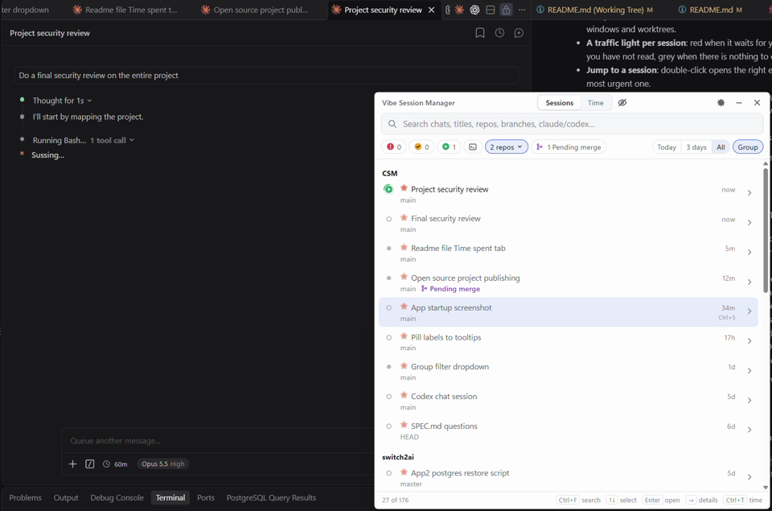

# Using Vibe Session Manager

## The list

The list is a normal window: it shows in the taskbar and Alt+Tab, and remembers where you put it. Closing it hides it to the tray, and clicking the tray icon brings it back. To stop the app, use **Quit** in the tray menu. Turn on **Start at login** in Settings or the tray menu so the app is there after a restart.

Click a session to show its details (last prompt, last reply, time) and click again to hide them. Double-click opens the session in its editor.

▶ [Watch the 30-second demo](images/vibe-session-manager-show-activate-vscode.mp4) of opening sessions from the list.

**Hide** (right side of the details) leaves a session out of the list, the counts, the tray badge and notifications. Its files are not touched, and it can be undone: the eye next to Sessions/Time shows hidden sessions (dimmed), and their details have **Unhide**. Hidden sessions are stored in `~/.vibe-session-manager/state.json`. Their time still counts in the Time tab.

**Rename** a Claude Code session with the pencil that appears right of its title when you point at it, or with `F2`. A small field opens over the title with the title selected: `Enter` keeps the new name, `Esc` or clicking elsewhere cancels. The name is stored in the session's own transcript as a `custom-title` line, the same way Claude Code's `/rename` does it, so Claude Code shows it too. Codex sessions cannot be renamed here: Codex also keeps the title in a SQLite database the app does not touch, so Codex would go on showing the old name.

**Labels** (details, or `Ctrl+L`) mark sessions as to-dos. It opens a checklist with **Pending merge**, **Needs attention**, **Review with peer** and any labels you added yourself. Below the list you can type a new label, pick one of 10 icons and add it. The × next to a label deletes it everywhere. A session shows its labels on its row, comma-separated, and each label in use gets a chip next to **Open only** that filters the list. Labelled sessions stay in the list whatever the time range is. Labels do not change the traffic light or the tray badge. They are stored in `~/.vibe-session-manager/labels.json`.

**Search** matches titles, repo, worktree and branch names, folders and the conversation itself (prompts, replies and pasted text, not tool output). Type `claude`, `codex` or `cowork` to see only one agent.

## Shortcuts

| Shortcut | Action |
|---|---|
| `Ctrl+Alt+Space` (global) | Open the list with focus in search |
| `Ctrl+Alt+Enter` (global) | Jump to the most urgent session (red before yellow, longest waiting first). Press again for the next one |
| `Ctrl+F` | Go to search (selects what is there) |
| `↑` `↓` `Enter` | Select, open |
| `→` / `←` | Show / hide details |
| `Ctrl+1` … `Ctrl+9` | Open row 1–9 |
| `Ctrl+E` | Toggle seen / unread. A red or yellow session is marked as seen, a grey one as unread (yellow). No effect on a working (green) session |
| `Ctrl+U` | Mark as unread: the session turns yellow again until you write in it or mark it as seen |
| `Ctrl+L` | Labels for the selected session |
| `F2` | Rename the selected Claude Code session |
| `Ctrl+T` | Next tab: Sessions, Time, Archive, Work |
| `Ctrl` `+` / `Ctrl` `-` / `Ctrl+0` | Larger / smaller / normal text. The size is remembered |
| `Esc` | Clear search, then minimize |

You can change the global shortcuts in Settings.

## Traffic light

| | Meaning |
|---|---|
| Red | Waiting for you: permission or question. Dashed ring with `?` = guessed |
| Green | Working. A ring turns around the play icon |
| Yellow | Finished a turn you have not seen |
| Grey | Nothing to do. Filled dot = open, ring = closed |

When a session finishes a turn, the app plays a short "blop", but not when that session's own window is in front: a VS Code or Cursor window on its folder, or the Codex app for Codex app threads. To check that, the app reads the title of the window in front (it takes about a second, so the sound comes a moment after the turn ends). Several sessions finishing together make one sound. Turn it off, or let it always play, under Settings → Sound.

The tray icon shows the number of red and yellow sessions. While a session is working, a green ring turns around it, and the taskbar button shows Windows' moving green progress bar.

### Claude Code hooks (optional)

Without hooks, the light is guessed from the end of the transcript. **Install hooks** (banner, Settings or tray menu) adds a small hook to `~/.claude/settings.json` for the `Notification`, `Stop`, `UserPromptSubmit`, `SessionStart` and `SessionEnd` events. The hook records session id, event name, time and notification text in `~/.vibe-session-manager/events.jsonl`. It never records prompts, always exits 0 and gives up after 800 ms, so it cannot block Claude Code.

Existing hooks and settings are kept, a backup is written to `settings.json.vsm-backup` the first time, and the hooks can be removed again from the same places.

## Codex

Sessions from OpenAI Codex (the Codex app, the Codex VS Code extension and the CLI) are listed next to the Claude Code sessions. An icon left of the title shows which agent a session belongs to: a starburst for Claude Code, `>_` for Codex.

The app reads `~/.codex` (set `VSM_CODEX_DIR` to use another folder) and never writes to it:

- the conversation files in `sessions/`, for prompts, replies, folder, branch and activity,
- `session_index.jsonl` for the titles the Codex UI shows,
- `thread-writer-locks/`, which shows which threads Codex has open.

Status and activity:

- **Green** while Codex works on a turn. A turn that has written nothing for 30 minutes counts as stuck, not working.
- **Yellow** when a turn finished and you have not seen it. This comes from Codex's own turn events, so it is reliable without any hooks.
- **Red is not shown for Codex.** Codex does not write anything to disk when it waits for an approval, so a waiting session shows as green.
- **Grey** with a filled dot while Codex has the thread open, a ring when it is closed.
- Active time counts in the Time tab like Claude Code sessions.

Subagent and review threads are left out, as in Codex's own list. A new Codex chat shows up once you have sent its first message; Codex does not save it before that.

Double-clicking a session opens it where it was started: `codex://threads/<id>` for the Codex app, the folder plus `vscode://openai.chatgpt/local/<id>` for the VS Code extension, and for the CLI the command `codex resume <id>` is copied.

## Cowork

Cowork sessions from the Claude desktop app are listed too. Cowork runs Claude Code underneath, but gives every session its own private config folder, so these transcripts never reach `~/.claude`. The icon left of the title is the starburst on an orange tile.

The app reads Claude Desktop's `local-agent-mode-sessions` folder (under `%LOCALAPPDATA%\Packages\Claude_*\LocalCache\Roaming\Claude\` for the Microsoft Store build, else `%APPDATA%\Claude\`; set `VSM_COWORK_DIR` to use another folder) and never writes to it:

- each session's transcript under `local_<id>/.claude/projects/`, for prompts, replies and activity,
- `local_<id>.json` for the title the Claude app shows, the folder you gave the session and whether it is archived,
- `local_<id>/.claude/sessions/` for the live status while the session runs on this machine.

What is different from Claude Code sessions:

- **Repo** is the folder you gave the session. Sessions without a folder are grouped under **Cowork**, and their folder is the session's `outputs` folder, where Cowork puts the files it makes.
- **Title** is the one from the Claude app, so renaming here is not offered.
- **No branch**: Cowork does not work in a git checkout.
- **Red and green** come from the live status file, like Claude Code without hooks, so a waiting session is a guess. Sessions that run in Cowork's Linux VM show no live status.
- **Archived** sessions are left out, as in the Claude app.
- Double-click cannot open the session: the Claude app has no link to one. The title is copied, so it can be found in the Cowork sidebar.

Chats in the Claude app's Chat tab are kept on Anthropic's servers and are not on your disk, so they are not listed.

## Plan usage

Under the title bar, one row per agent shows how much of its **5-hour** and **weekly** limit is used, as a bar with the percentage and the time to the next reset. The bar is blue below 70 %, amber from 70 % and red from 90 %. Hover a bar for the exact reset time and where the number came from. A dash means that window has ended and nothing newer was read. Claude Code and Cowork share your Claude plan, so one Claude row covers both.

- **Codex** is read from its session logs (`~/.codex/sessions`), which carry the limits on every turn. It is as fresh as your last Codex turn.
- **Claude** is read live from Anthropic, but only after you turn on **Read live Claude usage from Anthropic** in Settings. The app then asks `api.anthropic.com` every five minutes, using the sign-in token Claude Code keeps in `~/.claude/.credentials.json`. The token is sent only there, is not saved by the app and is never refreshed by it, so Claude Code stays signed in. If the token has expired, use Claude Code once and it refreshes. The service is not documented by Anthropic and may change; if it answers in a format this version does not know, the row says so instead of showing wrong numbers. When your plan has a separate weekly limit for one model, such as Fable, it gets its own line under Claude, with its bar under the weekly one.
- **Without the opt-in** Claude's row only appears if a Claude Code status line helper writes `~/.claude/vscode-claude-status-cache.json`. Otherwise a one-line note offers to turn live usage on.

**Show the 5-hour and weekly usage** in Settings hides the strip and stops all reading. Accounts without a Claude subscription (API key only) have no such limits.

## Archive

Claude Code only keeps old transcripts for a while, and its history only shows the sessions of the folder that is open. The **Archive** tab keeps a copy of every conversation, so it can still be found after a window is closed, a worktree is removed or Claude Code has cleaned up.

**It is off until you turn it on**, in the tab itself or under Settings → Conversation archive. The first pass copies everything that is on disk, and after that the app copies what is new once a minute. Sessions that were already deleted before you turned it on cannot be recovered.

**Search** finds words in any order, in the titles, names and all the text of the conversations: prompts, replies, pasted text and what subagents wrote. Without a search the tab lists every session, newest first.

**Click a result** to read the conversation as Markdown, with the matches highlighted. In a narrow window the reader takes the place of the results, and from about 820 pixels wide they are side by side.

| Key | Action |
|---|---|
| `↑` `↓` | Select a result |
| `Enter` | Read the selected result, then go to the next match |
| `Shift+Enter`, `F3`, `Shift+F3` | Previous, next, previous match |
| `Ctrl+Enter` | Open the selected session |
| `Ctrl+F` | Go to search |
| `Esc` | Close the reader, then clear the search, then minimize |

**Open** is on every result and in the reader. The app checks what is still there each time it lists a session:

- **Folder and transcript exist:** **Open** works like double-clicking the session in the list.
- **Something is gone:** the row says so, and the button is **Restore**. The app shows what it will do and asks first. It then opens the session.
  - **A worktree** is created again with `git worktree add`, on its branch, while its repo exists. The files are what is committed now, so uncommitted work from the old worktree does not come back. If the branch is gone it is created from the repo's current commit, and if it is checked out elsewhere the worktree gets its commit detached.
  - **Any other folder** comes back empty, so the session has somewhere to run.
  - **A deleted transcript** is copied back from the archive to where it was.
- **Cowork sessions** open in the Claude app, so the title is copied, as in the list.

What the copies hold, in `~/.vibe-session-manager/archive/sessions/<session id>/`:

| File | Content |
|---|---|
| `conversation.md` | Prompts, replies, pasted text and subagent text. Readable without the app |
| `raw/` | Gzipped copies of the session's own files, including tool calls, their output, subagents and saved tool results |
| `meta.json` | Title, repo, folder and how far each file has been copied |

The Markdown leaves out what the agent was told behind the scenes, such as reminders and compaction summaries, and tool calls and their output. Those are in `raw/`. Thinking is not shown either: most of it is not stored as readable text.

**The copies are not encrypted and include everything the agents read, which can be `.env` files and tokens. Keep the folder out of cloud sync.** They stay on your machine, and nothing is deleted automatically. Expect the archive to take a bit under half the size of the transcripts. Turning the setting off stops copying and keeps what is there, which you can still search. To remove it, delete the `archive` folder; **Open folder** takes you there.

## Work

The **Work** tab takes a piece of work from start to finish in its own git worktree, so it does not get in the way of what is checked out in the repo.

**Create worktree** asks for a repo and a name. The repos are those with a session in the last 30 days and those you made a worktree in before, with the last one used picked; **Other folder…** adds one. The app then runs `git worktree add`, which makes the folder `<repo>/.claude/worktrees/<name>` on a new branch `<name>`, from the branch that is checked out in the repo's root. It opens the folder in your editor, and the worktree shows in the list. The name can have letters, digits, dash, underscore and dot.

A new worktree has only the files git tracks, so the form has two options for what else to bring along. The app remembers what you chose last.

- **Copy .env files** copies the repo's `.env*` files that git does not track, from the root and from subfolders, to the same places in the worktree. Hover the option to see which. Files inside `node_modules` are left out, and a file that is already in the worktree is not overwritten.
- **node_modules** can be left out, linked or installed:
  - **Link to the repo's** makes a link (a junction on Windows) from the worktree to each `node_modules` folder the repo has next to a tracked `package.json`. It is instant and takes no disk space, but the worktree and the repo then share the packages: an install in either changes both. **Remove such a worktree with Clean up on this tab.** It takes the links away first. `git worktree remove` on its own follows the link and deletes the repo's `node_modules`.
  - **Run npm install** runs the install in the worktree's root after it is created, with its output on the tab. With a `pnpm-lock.yaml`, `yarn.lock` or `bun.lock` in the root it runs that package manager's install instead.
 If the repo does not ignore `.claude/worktrees` yet, the app adds it to `.git/info/exclude`, which is local and never committed.

**Work in progress** lists every linked worktree of those repos, also the ones Claude Code or you made, and the repo's own folder when it has work in it, with where each stands:

| State | Meaning |
|---|---|
| Agent working | A session is busy in the folder. Nothing can be done to it until the session is done. |
| Uncommitted | It has changed or new files. |
| New | Nothing has been committed on its branch yet. |
| Pending merge | Its commits are not in the base branch. The line also says whether the branch is pushed. |
| Ready for cleanup | Everything is committed and in the base branch. |
| Folder gone | The folder was deleted, but git still has the worktree on record. |

Work you do in the repo's own folder, without a worktree, is in the list too, as a row named after its branch and marked **repo folder**. It is only there while something is left to do: changed or new files, commits that are not in the default branch when the folder is on another branch, or commits that are not pushed (**To push**). It has **Open**, **Commit work**, **Push** and **Merge into …**, which work as described below, and no **Clean up**: the repo's own folder is never removed. A folder that stays on a long-lived branch such as `develop` stays in the list for as long as that branch is ahead of its base. Branches that are not checked out in any folder are not listed.

The base branch is the one the branch was made from. For a worktree the app created, that is the branch that was checked out in the repo's root at the time. For other worktrees, and for the repo's own folder, the app reads it from git's reflog, which has the branch that was named or checked out when the branch was made. The reflog is local and git clears entries after about 90 days, so for a branch made on another machine or long ago the base is the repo's default branch. A branch counts as merged when the base has its commits, here or on the remote as last fetched, or when merging it would change nothing, which is how a squash merge shows. The refresh button runs `git fetch` first, so merges done on GitHub show.

The buttons on a worktree:

- **Open** (or double-click) focuses the editor window that has the folder, or opens one.
- **Commit work** runs the agent picked at the top (Claude Code or Codex, whichever is installed) in the worktree, without a window. It is asked to look at the changes, stage what belongs to the work and commit it in the style of the repo, and not to push or change files. What it says and runs shows as it happens, and **Stop** ends it. Claude Code gets permission for `git status`, `diff`, `log`, `show`, `add` and `commit` and for reading files, on top of what your own Claude Code settings allow. The run is an ordinary session of that agent, so it uses your plan and shows on the Sessions tab.
- **Push** runs `git push -u` to the repo's remote.
- **Merge into …** asks first, then merges the worktree's branch. The button names the base branch; the arrow next to it lists the repo's other local branches (DEV, master, …), so the same work can go into more than one. A worktree that is already in its base only has **Merge into…** with the list. Where the chosen branch is checked out in a folder, the merge runs there. Where it is not, the branch is moved forward if it has no commits of its own, and otherwise the merge is made in a temporary checkout that is removed again. A merge with conflicts is undone, and you merge by hand. The state in the list keeps following the base branch. Branches that only exist on the remote are not listed; check them out once to merge into them.
- **Create PR** asks first, then opens a pull request for the branch into its base branch with the GitHub CLI (`gh pr create --fill`), so the title and description come from the commits. If the remote does not have the branch as it is here, it is pushed first. The button is there when the branch has commits that are not in its base and the repo has a remote; it needs `gh` installed and signed in, and the base branch on the remote. Afterwards the row says the pull request is open and the button becomes **Open PR #…**, which opens it in the browser. The refresh button also asks GitHub for the repo's open pull requests, so one made elsewhere shows too. The app does not remember them between runs; refresh to see them again. When the pull request is merged on GitHub, a refresh turns the worktree to **Ready for cleanup**.
- **Clean up** asks first, then removes the worktree and deletes its branch. If that would lose uncommitted files or commits that are not merged, it says exactly what, and deletes only if you choose **Delete anyway**. A branch on the remote is left alone.

After a commit, the push, pull request, merge and cleanup buttons are also in the header of the output.

**History** at the bottom lists what the tab has done. **Command log** shows every command the tab ran, exactly as it was run, with all its output and exit code: git commands, the GitHub CLI's, the agent's command line with the prompt it was given and its raw output, the install, the editor command, and each file that was copied or linked. **Open file** opens the whole log, and **Copy** takes what is shown. **Log** on a row shows only what was run for that worktree, and **Log** next to a line of the history shows only what that one action ran, also after the worktree is gone; **Show all** goes back to the whole log. What was run before the app had this is only in the whole log. Reading where the worktrees stand, which happens every 20 seconds while the tab is open, is the one thing that is not logged. When the log passes 5 MB it is renamed to `commands.1.log` and a new one starts.

## Time tracking

The **Time** tab (`Ctrl+T`) shows active time per day: a total, then each repo, then each session with its periods. A pause longer than the idle gap (90 min by default, see Settings) ends a period and is not counted. Sessions that run in parallel both count, so a day's total can be longer than the day. **Copy day as CSV** puts the day on the clipboard, separated by semicolons.

Time is stored as one JSON file per day in `~/.vibe-session-manager/time/`. The files keep the time after Claude Code deletes old transcripts. The CSV has an `agent` column (`claude` or `codex`).

## Files the app keeps

Everything lives in `~/.vibe-session-manager/`:

| File | Content |
|---|---|
| `config.json` | Settings |
| `state.json` | Seen marks, unread marks and hidden sessions |
| `labels.json` | Labels and which sessions have them |
| `time/<YYYY-MM-DD>.json` | Active time per day |
| `window.json` | Window position and size |
| `archive/` | Copies of your conversations (only if you turned on the archive) |
| `work.json` | The Work tab's repos, chosen agent and the base branch of each worktree it created |
| `work/journal.jsonl` | What the Work tab did: one line per create, commit, push, pull request, merge and cleanup |
| `work/commands.log` | Every command the Work tab ran, with its output |
| `hook.cjs`, `events.jsonl` | The Claude Code hook and the events it records (only if hooks are installed) |

Deleting the folder resets the app. Remove the hooks first (Settings), or Claude Code will report a missing hook script.
